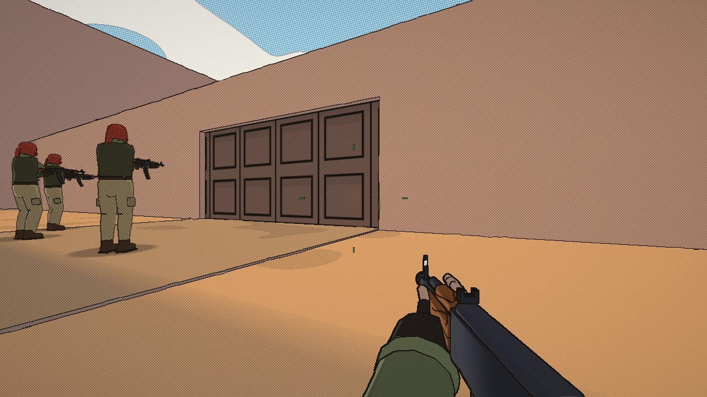
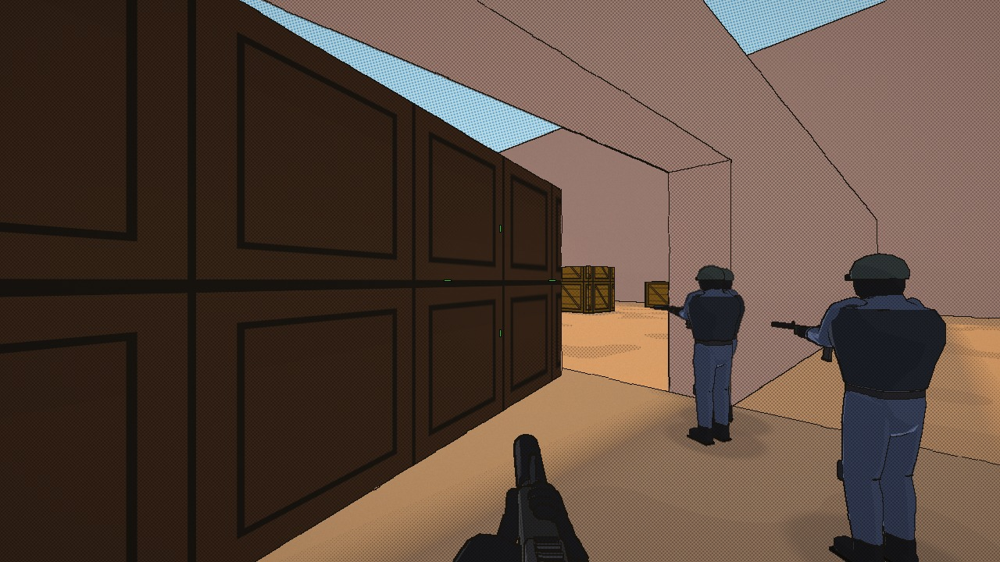
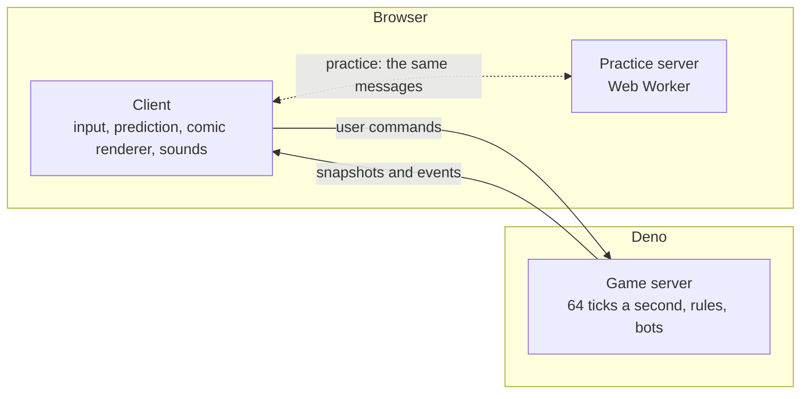

# ComicStrike

**A multiplayer FPS in the browser that looks like a printed comic.**

Flat colors, ink outlines, halftone dots and sound words (BLAM!, KAPOW!) on top of CS:GO's mechanics: the movement, recoil and spray patterns, armor, economy, the bomb and hostages. The maps are classic Counter-Strike 1.6 maps, read straight from their `.bsp` files.

[](LICENSE)
[](https://deno.com/)


<p>
  
  
</p>

<sub>Bots playing a 5 against 5 on `de_playground`, the map that comes with the repository.</sub>

Everything is written from scratch in plain JavaScript:
- WebGL2 for the graphics;
- WebTransport (UDP over QUIC) for the netcode;
- Web Audio for the sounds.

There are no dependencies and no build step. There are also no image or sound files: every texture, model and sound is generated in code.

## Quick start

You need [Deno](https://deno.com/) 2.9 or newer, and Chrome or Edge (online play uses WebTransport).

```bash
git clone https://github.com/stevenrezzonico/ComicStrike.git
cd ComicStrike
deno task start
```

Then open <http://127.0.0.1:27015/>, choose **Practice** and play against bots. Practice needs no Counter-Strike maps: pick `de_playground`.

Use `127.0.0.1` rather than `localhost`, because Chrome tries IPv6 first and the game server listens on IPv4.

## Features

- **The comic print:**
  - one full-screen pass draws ink lines on every silhouette, crease and part;
  - shade is printed as halftone dots, with a slightly misregistered color plate;
  - surfaces get flat colors and a few ink marks by material (bricks, planks, tiles), colored like the original textures.
- **CS:GO gameplay:**
  - the movement: acceleration, friction, air strafing, crouch jumps;
  - the weapons, with their real stats and spray patterns, and bullet penetration;
  - armor, rounds and the economy, with the radial buy menu;
  - planting and defusing the bomb, carrying hostages, all five grenades.
- **Netcode:** a 64-tick server, client-side prediction that matches the server bit for bit, interpolation and lag compensation.
- **Bots** that navigate any map, fight, plant, defuse and rescue hostages, at four difficulties.
- **Practice anywhere:** the real server runs inside the browser in a Web Worker, so you can play against bots without running a server.
- **A CS:GO-style console** (`` ` ``) with the familiar commands, cvars and binds.
- **Also:**
  - spectating, and taking over a bot of your team;
  - a radar drawn from the map itself;
  - doors, buttons and breakable crates and glass;
  - synthesized cartoon sounds, positioned in 3D.

### Game modes

| Mode | `game_type` / `game_mode` | In short |
|---|---|---|
| Casual | 0 / 0 | Relaxed rounds, free armor, a long buy time, no side swap |
| Competitive | 0 / 1 | CS:GO's 5 against 5, first to 16 rounds |
| Wingman | 0 / 2 | 2 against 2 on one bomb site |
| Arms Race | 1 / 0 | A new weapon for every kill, instant respawns; a kill with the knife, the last weapon, wins |
| Demolition | 1 / 1 | Bomb rounds without buying; a kill earns a better weapon for the next round |
| Deathmatch | 1 / 2 | Free for all, instant respawns, points per kill |
| Demo | 2 / 0 | A playground: free buys, infinite ammo, you can't die |

Pick a mode in the Practice menu. On a server, set `game_type` and `game_mode` in `cfg/server.cfg`, or switch on the fly with `rcon game_type 1; rcon game_mode 0; rcon map de_dust2`.

## Maps

The repository includes one map of its own, `de_playground`. It is a small yard with something of everything:
- stairs and a ladder tower;
- crates and glass to break;
- a conveyor belt and a pool;
- three kinds of doors;
- both bomb sites.

Counter-Strike 1.6 maps belong to Valve and are not included. If you own the game, copy the `.bsp` files from its `cstrike/maps` folder into `maps/`. The server starts on `de_dust2` by default; without it, start on the included map:

```bash
MAP=de_playground deno task start
```

In PowerShell: `$env:MAP = "de_playground"; deno task start`.

## Controls

The defaults are CS:GO's. Change them in Settings, then Controls, or with `bind` in the console.

| Key | Action | Key | Action |
|---|---|---|---|
| W A S D | Move | Mouse 1 / 2 | Fire / scope, burst, silencer |
| Space, mouse wheel | Jump | R | Reload |
| Ctrl | Crouch | E | Use (doors, defuse, hostages) |
| Shift | Walk | F | Inspect the weapon |
| 1 – 5 | Weapon slots | G | Drop the weapon |
| Q | Last weapon | B | Buy menu |
| Tab | Scoreboard | M | Choose team |
| `` ` `` | Console | Esc | Pause menu |

### Console

In practice, server commands work without a password, typed with or without `rcon`. Some useful ones:

| Command | What it does |
|---|---|
| `bot_add_t`, `bot_add_ct`, `bot_kick all` | Add or remove bots |
| `bot_difficulty 0`–`3` | Easy to expert (applies to new bots) |
| `map de_inferno` | Change the map |
| `mp_restartgame 1` | Restart the match |
| `mp_roundtime 5`, `mp_freezetime 0`, `mp_startmoney 16000` | Round rules, applied from the next round |
| `sv_cheats 1`, then `setpos x y z` / `setang pitch yaw` | Move yourself (`setang` works without cheats) |
| `cl_showfps 1`, `net_graph 1` | Frame rate, network graph |
| `r_comic 0` | The plain render, without the print |

## Running a server

`deno task start` serves the pages on TCP 27015 and the game on UDP 27015. In development it creates its own short-lived certificate, which browsers accept by its hash.

It reads these environment variables:

| Variable | Default | Meaning |
|---|---|---|
| `MAP` | `de_dust2` | The map to start on (`maps/<MAP>.bsp`) |
| `HTTP_PORT`, `GAME_PORT` | `27015` | TCP port for the pages, UDP port for the game |
| `BIND` | `0.0.0.0` | The address to listen on |
| `HOSTNAMES` | `localhost,127.0.0.1,::1` | Names the server answers to |
| `RCON_PASSWORD` | none | Enables `rcon` for players who know it |
| `TLS_CERT`, `TLS_KEY` | none | A real certificate: HTTPS pages, no certificate pinning |
| `REDIRECT_PORT` | none | Redirects plain HTTP on this port (e.g. 80) to the site |

Server settings go in `cfg/server.cfg`, which uses the same syntax as a CS:GO `server.cfg`. Each mode's settings live in `cfg/gamemode_<mode>.cfg`; put your own overrides for a mode in `cfg/gamemode_<mode>_server.cfg`. The server's terminal is a console too: type `status`, `bot_add`, `changelevel de_nuke`.

[deploy/README.md](deploy/README.md) covers hosting on a Linux machine as a systemd service: your own domain, a Let's Encrypt certificate and port 443.

### Troubleshooting

- **The page loads but the game never connects:**
  - open the page through `127.0.0.1`, not `localhost`;
  - on a remote server, check that the firewall lets **UDP** through on the game port, not only TCP.
- **The game freezes while loading:** an ad blocker may be blocking a script. Allow the site in it.
- **Practice starts with the wrong rules after an update:** restart the server, so it serves the new files.

## How it works



- `shared/` is the code the client and the server both run: map loading, movement, collision, weapons, rules, the wire protocol. The client predicts with exactly the server's code.
- `client/` is the browser game:
  - a deferred renderer: the scene is drawn into a G-buffer, then a single composite pass prints ink, dots and color;
  - models and animation built in code;
  - the HUD, the menus and the synthesized sound.
- `server/` is the Deno server: the WebTransport endpoint, the game rules, the bots, the console.
- `tools/` holds generators:
  - weapon data from CS:GO's game files;
  - texture colors measured from the original WADs;
  - the playground map, written as a real BSP file.

[CLAUDE.md](CLAUDE.md) is the detailed design document: every system, its rules and its approximations.

## Development

```bash
deno task test   # the test suite (tests that need a Valve map skip when it is missing)
deno lint
```

Some ground rules:
- **No dependencies:** no npm or jsr packages, no bundler, no WebAssembly.
- **No asset files at runtime:** textures, models and sounds stay procedural.
- **No allocations in hot paths:** the main loop and the server tick avoid garbage-collection spikes.
- **Never commit Valve's files:** maps in `maps/` and WADs in `wads/` are git-ignored; only `de_playground.bsp` is tracked.

## License

The code is under the [MIT license](LICENSE). Counter-Strike, its maps and its textures belong to Valve and are not part of this project.
