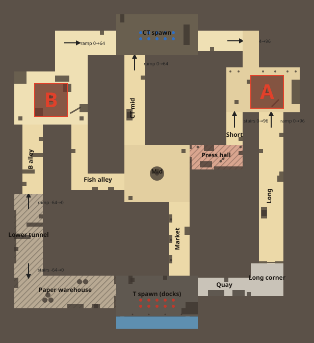

# de_inkwell

ComicStrike's own defusal map: a harbour town round a print works. Built by
`tools/gen_inkwell.js` as a map editor project (`maps/de_inkwell.cmap.json`: the editor's
Example button opens it) and compiled into `maps/de_inkwell.bsp`.

## Layout

- **T spawn** on the docks, south, over a canal (jump the railing and you swim; ladders at
  both ends climb out). Three exits: east along the quay to Long, north up Market to Mid,
  west into the paper warehouse.
- **A** (north-east) is a plaza raised 96 units with a crate stack, a stage and a portico
  on pillars, reached up the Long ramp (through a gate of two swinging doors), up the Short
  stairs out of the press hall, or from the CT side down a gentle ramp.
- **B** (north-west) is a yard at street level with a hut (a ladder to its roof), crate
  stacks and a box at each T entrance, reached out of the B alley (from the lower tunnel
  under the warehouse), from Mid through the Fish alley, or from the CT side down a ramp.
- **Mid** has a round fountain and joins Market, CT mid, the press hall (a doorway beside a
  breakable window; inside, presses, ink drums and a conveyor under glass skylights) and
  the Fish alley.

## Sightlines

Bots showed where the long lines were: they stop and fight along any of them.

- Market and CT mid are offset, so no line runs from spawn to spawn; the Fish alley and the
  press hall are offset across Mid.
- The lower tunnel and the B alley each have a zigzag of two overlapping half walls: in a
  straight line they saw 3000 units from the warehouse onto B.

## Timings

At a run (250 units a second), along the bot navigation's paths (doors open), from the
first spawn of each team (`test/inkwell.test.js` keeps them in range):

| Route | Time |
|---|---|
| T to A (Short) | 19.1 s |
| T to A (Long) | 20.5 s |
| T to B (Fish alley) | 19.7 s |
| T to B (lower tunnel) | 20.5 s |
| CT to A | 10.2 s |
| CT to B | 8.4 s |
| T to Mid / CT to Mid | 8.9 s / 9.9 s |

Valve's maps for comparison (measured the same way): de_dust2 T 18.8 / 21.2 s, CT
10.4 / 7.8 s; de_inferno T 18.1 / 17.5 s, CT 9.3 / 9.6 s.

## Bots

Headless 5v5s of hard bots (12 game minutes, four seeds): 70-90 kills, plants on both
sites, stuck under 1 % of the time. B rounds usually end in the Fish alley before the bomb
gets there; with the site forced and nobody shooting, T bots plant on either site.
