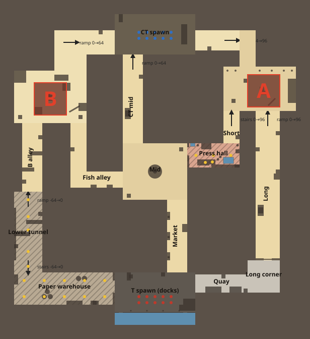

# de_inkwell

ComicStrike's own defusal map: a harbour town round a print works, and the showcase of every
map element the game plays (see Machines), each placed where it does something in a round and
off every lane the bots take. Built by
`tools/gen_inkwell.js` as a map editor project (`maps/de_inkwell.cmap.json`: the editor's
Example button opens it) and compiled into `maps/de_inkwell.bsp`.

## Layout

- **T spawn** on the docks, south, over a canal (jump the railing and you swim; ladders at
  both ends climb out). Three exits: east along the quay to Long, north up Market to Mid,
  west into the paper warehouse.
- **A** (north-east) is a plaza raised 96 units with a crate stack, a stage and a portico
  on pillars, reached up the Long ramp (through a gate of two swinging doors), up the Short
  stairs out of the press hall, or from the CT side down a gentle ramp.
- **B** (north-west) is a yard at street level with a hut (a ladder to its roof), crate
  stacks and a box at each T entrance, reached out of the B alley (from the lower tunnel
  under the warehouse), from Mid through the Fish alley, or from the CT side down a ramp.
- **Mid** has a round fountain and joins Market, CT mid, the press hall (a doorway beside a
  breakable window; inside, presses, ink drums and a conveyor under glass skylights) and
  the Fish alley.
- **Lamps** (yellow on the plan) hang under every roof, where the sun never reaches: bulbs
  on a 320-unit grid in the warehouse and the tunnel, three spot lamps over the press hall's
  presses. Before them those floors were pitch dark (the roofs block the sun, the skylights
  let in only the sky).

## Machines

- **Press hall (Short):** a two-hand press: its platen comes down when the button on the press
  is pressed, but only after both valves (one on the west wall, one on the other press) have
  been turned; a sign says how. The conveyor along the south wall runs into a shredder that
  hurts whoever rides it in. Four ink drums break; the two in the middle explode, one setting
  the other off: a CT can blow up a push through Short. An ink vat of slime and a crucible of
  lava sit off the lane. Printed sheets dry on a line overhead. The window onto Mid and the
  skylights are see-through glass.
- **Canal (T spawn):** the water is 12 under the quay, so a swimmer leaps out where the railing
  has a gap. A barge ferries between the two ladders, waiting 3 s at each end, carrying whoever
  climbs on.
- **Quay:** a crate swings from a gantry overhead. Another, in the corner by the first
  container, can be shoved against it: then it is the step for a crouch jump onto the
  containers, a lookout over the quay.
- **Paper warehouse:** a mezzanine in the south-east corner, behind a glass balustrade, reached
  by a lift or a ladder. In its corner the paper chute drops whoever steps in onto the quay (one
  way). Two ceiling fans; a belt along the north wall carries runners west to the tunnel; a
  garage door at the top of the tunnel stairs rises when run into.
- **Mid:** the fountain holds ankle-deep water. A balcony on the south wall, 128 up, is reached
  only on a teammate's shoulders.
- **Net loft:** between the Fish alley and the B alley, shut by a gate that rises as far as the
  wheel on the Fish side has been turned (4 s of holding E for all of it); it stays where it is
  left. A slow, loud way round that only players take: the bots keep to their lanes.
- **Long:** a shop sign swings over the street.
- **A:** when the bomb goes off on the site, its crate stack explodes crate by crate, a fireball
  goes up over the stage and the stage's poster is torn down, until the next round.
- **Logic:** each round start (and the map's load) fires a relay whose list sets the barge off
  and, two seconds on, the fans.

Left out on purpose: weapons lying on the map (they would be free every round in every mode),
equipment or buying rules (the economy), fog (readability).

## Sightlines

Bots showed where the long lines were: they stop and fight along any of them.

- Market and CT mid are offset, so no line runs from spawn to spawn; the Fish alley and the
  press hall are offset across Mid.
- The lower tunnel and the B alley each have a zigzag of two overlapping half walls: in a
  straight line they saw 3000 units from the warehouse onto B.

## Timings

At a run (250 units a second), along the bot navigation's paths (doors open), from the
first spawn of each team (`test/inkwell.test.js` keeps them in range):

| Route | Time |
|---|---|
| T to A (Short) | 19.1 s |
| T to A (Long) | 20.5 s |
| T to B (Fish alley) | 19.7 s |
| T to B (lower tunnel) | 20.9 s |
| CT to A | 10.2 s |
| CT to B | 8.4 s |
| T to Mid / CT to Mid | 8.9 s / 9.9 s |

Valve's maps for comparison (measured the same way): de_dust2 T 18.8 / 21.2 s, CT
10.4 / 7.8 s; de_inferno T 18.1 / 17.5 s, CT 9.3 / 9.6 s.

## Bots

Headless 5v5s of hard bots (12 game minutes, four seeds): 74-102 kills, 3-7 plants, stuck
1.4-2.2 % of the time (the map before its machines: 71-90 kills, 5-7 plants, 1.2-2.1 %,
measured the same way). B rounds usually end in the Fish alley before the bomb
gets there; with the site forced and nobody shooting, T bots plant on either site.
